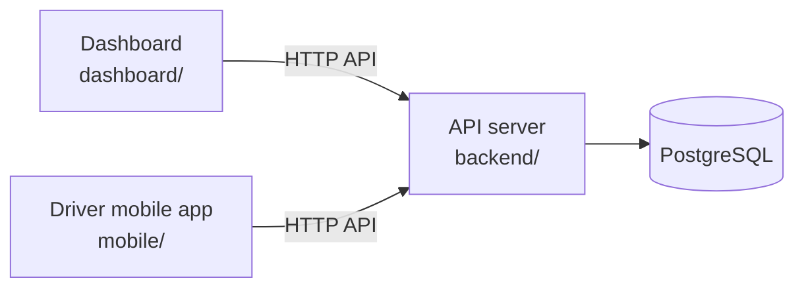

<div align="center">

# Nextsci Route Optimisation

**Open-source route planning for delivery and field-service teams.**

Dispatchers plan the day on the web. The server builds efficient routes. Drivers follow them on their phones.

[](backend/)
[](compose.yaml)
[](dashboard/)
[](dashboard/)
[](mobile/)
[](#contribute)

[Quick start](#quick-start) · [Architecture](#architecture) · [Develop without Docker](#develop-without-docker) · [Contribute](#contribute) · [Roadmap](#roadmap)

</div>

---

> [!NOTE]
> The project is at an early stage. The apps run and talk to PostgreSQL, and the dashboard has a sign-in screen, but no routing features exist yet. You can still shape the core design, so now is a good time to join.

## Why this project exists

Teams that deliver parcels, service equipment, or visit customers must answer the same question every morning. Which driver visits which stop, in what order, inside each customer's time window? Commercial tools answer it well, but they are closed and charge per driver.

Nextsci Route Optimisation gives you the same workflow as open source software that you can host yourself:

- Import the day's orders and stops.
- Describe your fleet, with vehicle capacities and driver shifts.
- Let the solver assign stops to drivers and order each route.
- Send each route to the driver's phone and follow progress live.

## Architecture

The project is a monorepo of independent apps. Each app has its own dependencies and lockfile. A self-hosted deployment runs the API server, the dashboard, and PostgreSQL. The driver app runs on phones. The project website is separate and is not part of a deployment.



| App | Path | Stack | Dev URL |
| --- | --- | --- | --- |
| API server | [`backend/`](backend/) | Django 6.1, Python 3.12, psycopg 3 | http://localhost:8000 |
| Dashboard for dispatchers | [`dashboard/`](dashboard/) | React 19, TypeScript, Vite 8 | http://localhost:5174 |
| Driver mobile app | [`mobile/`](mobile/) | Expo SDK 58, React Native, Expo Router | Metro on port 8081 |
| Database | [`compose.yaml`](compose.yaml) | PostgreSQL 17, pgvector | `localhost:5432` |

## Quick start

You need [Docker](https://docs.docker.com/get-docker/) with Compose. The stack starts all four services and applies database migrations.

1. Clone the repository.

	```bash
	git clone https://github.com/danirisdiandita/Nextsci-Route-Optimization.git
	cd Nextsci-Route-Optimization
	```

2. Create your local config file. Every variable is described in [`.env.example`](.env.example).

	```bash
	cp .env.example .env
	```

3. Start the stack.

	```bash
	docker compose up --build
	```

4. Create the master admin. The dashboard has no sign-up page, so accounts come from the server. The command asks for an email address and a password.

	```bash
	docker compose exec router-backend python manage.py createsuperuser
	```

5. Open http://localhost:5174 and sign in with that email address and password. To add accounts for your team, follow [Create the master admin and sign in](docs/admin.md).

> [!TIP]
> To open the mobile app in Expo Go on your phone, set `HOST_LAN_IP` in `.env` to your computer's LAN address, such as `192.168.1.20`. Then scan the QR code in the `mobile` service logs.

> [!WARNING]
> If PostgreSQL already runs on your computer, port 5432 is taken. Set `POSTGRES_HOST_PORT=5433` in `.env` before you start the stack.

## Develop without Docker

Run each app directly when you want faster reloads or a debugger. You need Python 3.12, Node.js 22, and a running PostgreSQL 17 server.

With [moon](https://moonrepo.dev) installed, one command installs what each app needs and starts the API server, the dashboard, and the website:

```bash
moon run :dev
```

The API server runs on http://localhost:8000, the dashboard on http://localhost:5174, and the website on http://localhost:5173. Before you first sign in, create the master admin. The task applies migrations first, then asks for an email address and a password:

```bash
moon run backend:createsuperuser
```

To run one app at a time instead, follow the steps below.

<details>
<summary><strong>API server</strong> (<code>backend/</code>)</summary>

1. Copy `.env.example` to `.env` in the repository root. Set the `POSTGRES_*` values for your PostgreSQL server.
2. Create the database named in `POSTGRES_DB`, if it does not exist.

	```bash
	createdb -h localhost -U postgres nextsci
	```

3. Install the dependencies and run the server.

	```bash
	cd backend
	python3 -m venv .venv
	.venv/bin/pip install -r requirements.txt
	.venv/bin/python manage.py migrate
	.venv/bin/python manage.py runserver
	```

Django reads its settings from environment variables. For local runs, it loads them from the root `.env` file. Variables that are already set in the environment take priority.

</details>

<details>
<summary><strong>Dashboard</strong> (<code>dashboard/</code>)</summary>

```bash
cd dashboard
npm install
npm run dev
```

The dashboard runs on http://localhost:5174. It sends `/api` requests to the API server at http://localhost:8000. Set `API_PROXY_TARGET` to use another address.

</details>

<details>
<summary><strong>Project website</strong> (<code>frontend/</code>)</summary>

The public website with the landing page. Self-hosted deployments do not need it.

```bash
cd frontend
npm install
npm run dev
```

</details>

<details>
<summary><strong>Driver mobile app</strong> (<code>mobile/</code>)</summary>

```bash
cd mobile
npm install
npx expo start
```

Install new packages with `npx expo install <package>`, not `npm install`. The Expo command picks versions that match the SDK. Read [`mobile/AGENTS.md`](mobile/AGENTS.md) before you change native configuration.

</details>

## Contribute

We welcome code, documentation, bug reports, and design feedback. Look for issues labeled [`good first issue`](https://github.com/danirisdiandita/Nextsci-Route-Optimization/issues?q=is%3Aissue+is%3Aopen+label%3A%22good+first+issue%22), or open an issue to discuss a larger idea before you write code.

### Send a pull request

1. Fork the repository and create a branch from `dev`.

	```bash
	git switch dev
	git switch -c feat/short-description
	```

2. Make your change in small, focused commits.
3. Run the full check. It installs, typechecks, and builds every app, and lints the dashboard and the website.

	```bash
	./scripts/check.sh
	```

4. Push your branch and open a pull request against `dev`, not `main`.

### Branches

| Branch | Purpose |
| --- | --- |
| `dev` | Integration branch. All pull requests target `dev`. |
| `main` | Stable releases. Maintainers merge `dev` into `main`. |

### Guidelines

- Keep each pull request to one change. Split unrelated fixes into separate pull requests.
- Add or update tests when you change behavior.
- Never commit secrets. The `.env` file is ignored by git, so keep credentials there.
- Describe new commands and folders in [`AGENTS.md`](AGENTS.md). AI coding agents and people both read it.

### Use AI coding agents

The repository includes instructions for AI coding agents. [`AGENTS.md`](AGENTS.md) describes the layout and commands, and [`CLAUDE.md`](CLAUDE.md) loads it for Claude Code. Put longer topic guides in [`.agents/`](.agents/) and link them from `AGENTS.md`.

## Project layout

```text
.
├── backend/          Django API server (config/ is the project package)
├── dashboard/        Vite + React dashboard that self-hosters deploy
├── frontend/         Project website with the landing page
├── mobile/           Expo driver app (routes live in src/app/)
├── scripts/
│   └── check.sh      Typecheck and build every app
├── .agents/          Topic guides for AI coding agents
├── compose.yaml      Full development stack
├── .env.example      Every configuration variable
└── AGENTS.md         Commands and conventions for contributors and agents
```

## Roadmap

The items below are planned. None of them exist yet. Comment on an item's issue, or open one, if you want to work on it.

- [ ] Data model for depots, vehicles, drivers, shifts, and stops with time windows
- [ ] REST API for that data model
- [ ] Order import from CSV files
- [ ] Route solver for capacity and time-window constraints
- [ ] Map view to plan and edit routes in the dispatcher web app
- [ ] Route list and turn-by-turn handoff in the driver mobile app
- [ ] Proof of delivery with photos and signatures
- [ ] Live driver location on the dispatcher map

## License

A license is not yet chosen. Until the repository includes a `LICENSE` file, the default copyright rules apply. Watch the repository for the license announcement before you reuse the code elsewhere.
